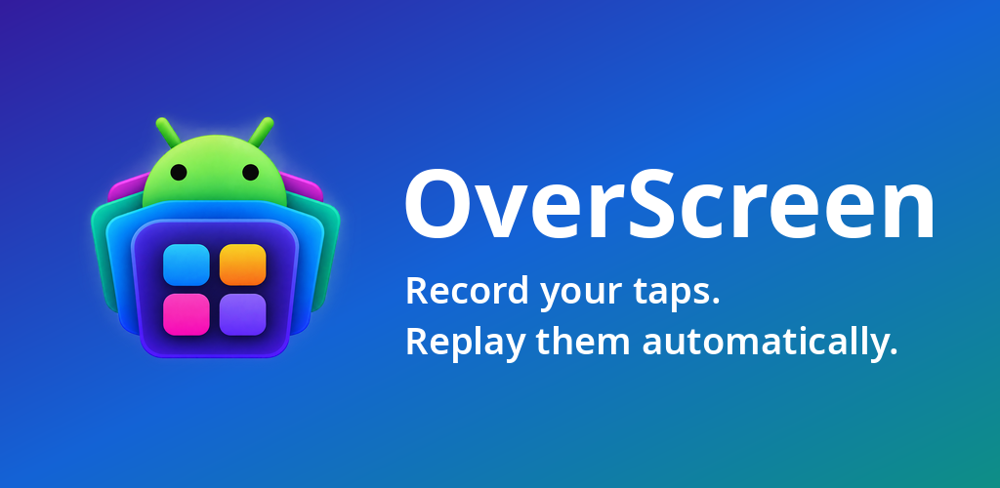
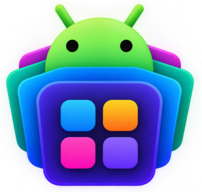
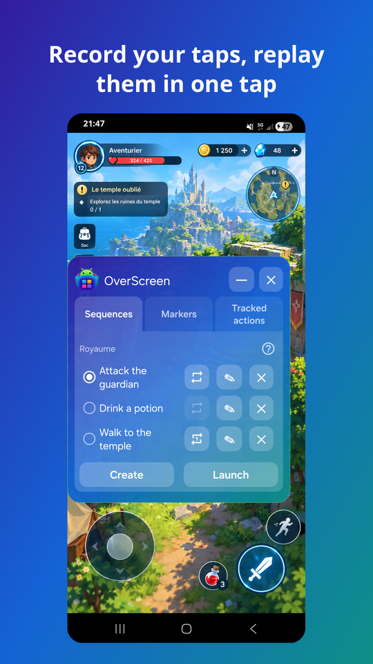
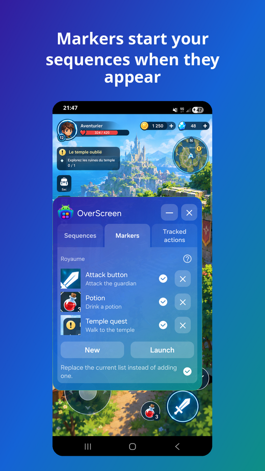
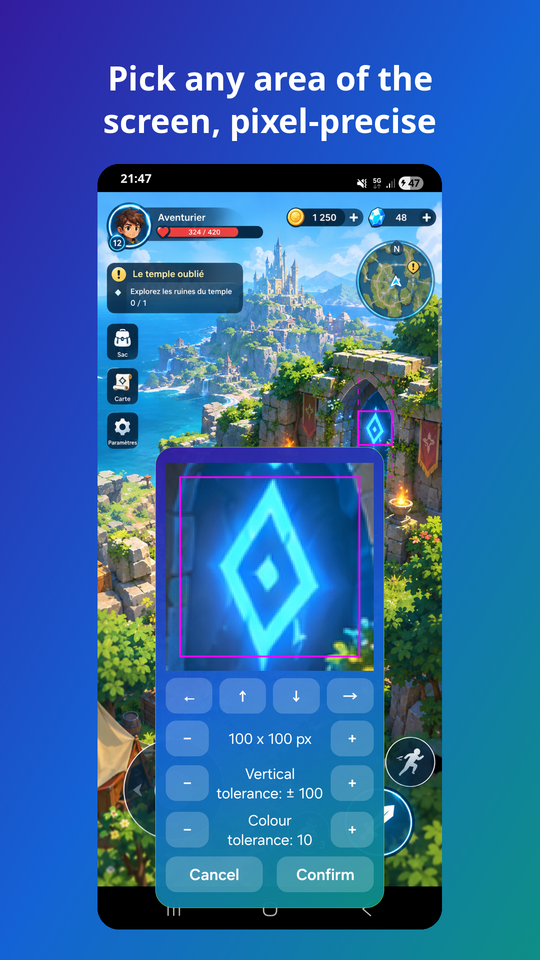
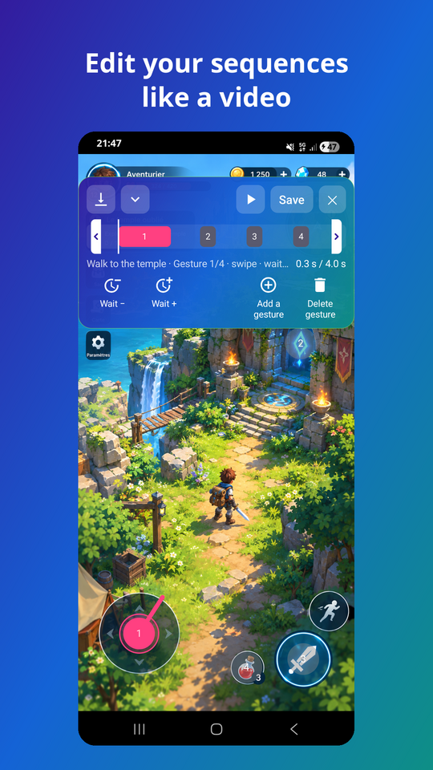
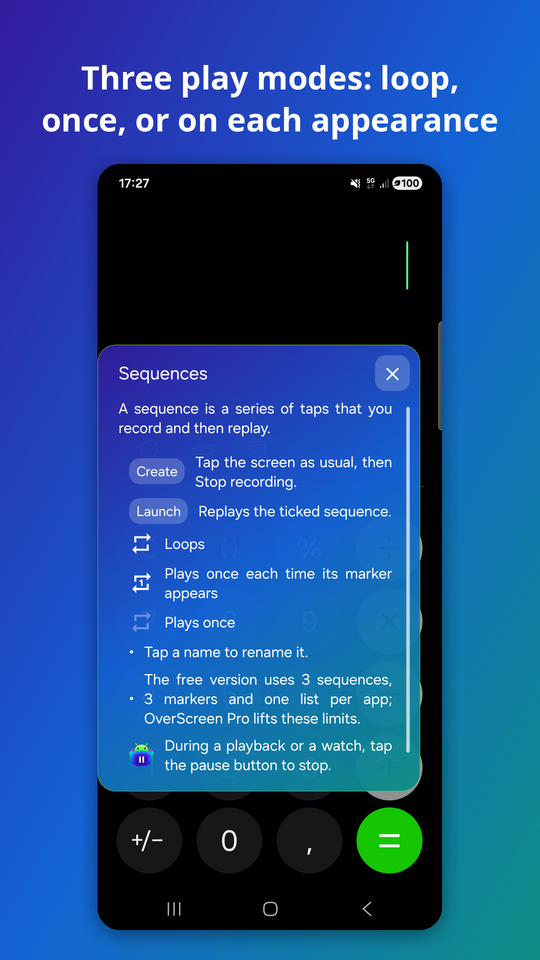
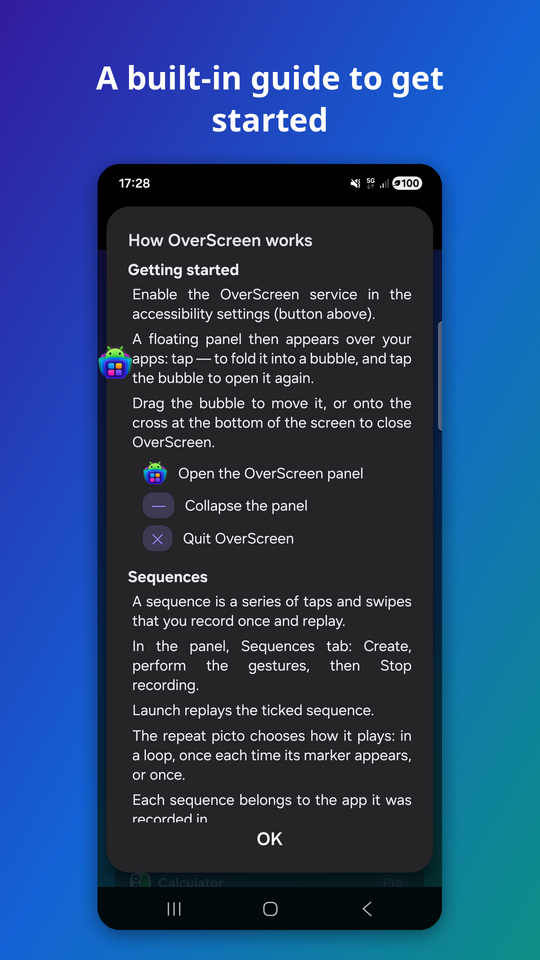

  

# &nbsp;&nbsp;&nbsp;OverScreen

[English version](README.md) · **Français**

**OverScreen** est une application Android d'**ariden** qui enregistre vos touchers et glissements et les rejoue, à la demande ou automatiquement quand une zone choisie de l'écran apparaît. Elle fonctionne comme un petit panneau flottant par-dessus vos autres applications, grâce à un service d'accessibilité.

  <a href="https://play.google.com/store/apps/details?id=com.ariden.overload&hl=fr">
     
    <strong>Télécharger OverScreen sur Google Play</strong>
  </a>

## Ce qu'elle fait

- **Enregistrer et rejouer** : enregistrez une série de touchers et de glissements dans une application, puis rejouez-la d'un toucher, en boucle, une fois, ou une fois à chaque apparition de son repère. Un bouton d'arrêt reste à l'écran pendant la lecture.
- **Panneau flottant** : le panneau s'affiche par-dessus vos autres applications ; réduisez-le en bulle et faites-le glisser où vous voulez. Un double toucher sur la bulle relance la surveillance de l'application à l'écran, sans ouvrir le panneau.
- **Repères** : choisissez n'importe quelle zone de l'écran, au pixel près ; quand elle apparaît, la séquence associée démarre. Une tolérance verticale et une tolérance de couleur la font reconnaître même si elle bouge ou change légèrement de teinte.
- **Suggestions de repères** : quand vous créez un repère, OverScreen peut vous suggérer les éléments à surveiller. Dans les applications qui décrivent leur écran à l'accessibilité d'Android, il lit leurs éléments cliquables ; dans les jeux, **Détecter les textes** lit le texte de l'écran par une reconnaissance de texte sur le téléphone, et **Détecter les éléments cliquables** lance une analyse d'image par IA sur le téléphone (Pro, environ une minute, téléphones d'au moins 5 Go de RAM). Les deux fonctionnent hors ligne, avec des modèles inclus dans l'application.
- **Trois sortes de repères** : les repères d'image sont reconnus par leurs pixels, les repères d'élément cliquable par l'identifiant ou le texte de l'élément à leur emplacement, les repères de texte par leur texte, relu à l'écran ; un badge sur la vignette signale les deux derniers.
- **Listes de repères** : regroupez vos repères en listes et surveillez-en plusieurs à la fois ; avec Pro, plusieurs listes par application sont surveillées ensemble.
- **Éditeur de séquences** (Pro) : modifiez une séquence comme une vidéo, avec une frise de ses gestes. Ajoutez, supprimez ou déplacez des gestes, tracez des courbes, réglez les attentes et coupez le début ou la fin ; écartez deux doigts sur la frise pour zoomer sur un moment.
- **Actions automatiques** (Pro) : la surveillance démarre d'elle-même quand vous ouvrez une application.
- **Actions programmées** (Pro) : une séquence se lance aux jours et heures que vous choisissez.
- **Sauvegarde** (Pro) : exportez tout dans un fichier et importez-le à nouveau, sur un nouveau téléphone par exemple.
- **Un ensemble par application** : les séquences et les repères appartiennent à l'application où ils ont été créés.
- **Aide et thèmes** : une aide illustrée dans chaque onglet du panneau, un guide complet dans l'application principale, et un thème automatique, coloré, clair ou sombre.
- **Respect de la vie privée** : pas de permission Internet, pas de compte, aucune donnée collectée. Rien ne fonctionne quand le téléphone est verrouillé.
- **29 langues** : anglais, français, espagnol, hindi, portugais du Brésil et du Portugal, allemand, russe, japonais, coréen, chinois simplifié et traditionnel, italien, indonésien, turc, polonais, néerlandais, ukrainien, roumain, vietnamien, arabe, thaï, bengali, ourdou, malais, philippin, tamoul, télougou et marathi ; l'arabe et l'ourdou s'affichent de droite à gauche.

La version gratuite offre 3 séquences, 1 repère et une liste par application, et crée les repères suggérés un à la fois. **OverScreen Pro**, un achat unique via Google Play, lève ces limites et ajoute l'analyse d'image par IA des jeux, plusieurs repères suggérés créés d'un coup, plusieurs listes par application, l'édition des séquences, les actions automatiques, les actions programmées et la sauvegarde (export et import).

## Captures d'écran

  
  
  
  
  
  

## Configurations prêtes à l'emploi

`configs/` contient un dossier par application, avec son fichier de sauvegarde (`config.json`) et un README. Pour en utiliser une, téléchargez-la et importez-la depuis OverScreen (la sauvegarde fait partie d'OverScreen Pro). L'import ajoute ou remplace uniquement les éléments de ce fichier et laisse intactes les configurations de vos autres applications. Il applique aussi le réglage « mettre en pause en quittant l'application » enregistré dans le fichier.

| Application | Configuration |
|---|---|
| Cinderfall | [`configs/cinderfall`](configs/cinderfall) |
| Joule Break | [`configs/joule-break`](configs/joule-break) |
| Pokemon GO | [`configs/pokemon-go`](configs/pokemon-go) |
| Rabbit Universe | [`configs/rabbit-universe`](configs/rabbit-universe) |
| Real Zombie War | [`configs/real-zombie-war`](configs/real-zombie-war) |
| Skyline Stack | [`configs/skyline-stack`](configs/skyline-stack) |
| TikTok | [`configs/tiktok`](configs/tiktok) |

## Code source

Ce dépôt contient les pages publiques et les configurations prêtes à l'emploi. Le code source de l'application se trouve dans un dépôt séparé et privé.

## Pages

Les pages sont publiées avec GitHub Pages à l'adresse <https://ariden83.github.io/overscreen/>. Chaque page existe en anglais et en français, et chacune renvoie vers toutes les autres et vers sa traduction.

| Page | Anglais | Français |
|---|---|---|
| Politique de confidentialité | [`/`](https://ariden83.github.io/overscreen/) (`index.md`) | [`fr.html`](https://ariden83.github.io/overscreen/fr.html) (`fr.md`) |
| Conditions d'utilisation | [`terms.html`](https://ariden83.github.io/overscreen/terms.html) | [`terms-fr.html`](https://ariden83.github.io/overscreen/terms-fr.html) |
| FAQ | [`faq.html`](https://ariden83.github.io/overscreen/faq.html) | [`faq-fr.html`](https://ariden83.github.io/overscreen/faq-fr.html) |
| Mentions légales | [`legal.html`](https://ariden83.github.io/overscreen/legal.html) | [`legal-fr.html`](https://ariden83.github.io/overscreen/legal-fr.html) |

## Adresses utilisées : ne pas les déplacer

Ces adresses sont utilisées en dehors de ce dépôt ; les fichiers doivent donc garder leur nom. Renommer ce dépôt les changerait toutes, car GitHub Pages ne redirige pas un dépôt renommé :

- la **politique de confidentialité** (`/` et `fr.html`) est l'adresse de politique de confidentialité de la fiche Google Play, et l'application l'ouvre depuis son écran de consentement ;
- la **FAQ** et les **conditions d'utilisation** sont ouvertes depuis le guide de l'application ;
- la fiche du Play Store renvoie vers la politique de confidentialité, les conditions d'utilisation et la FAQ.

## Modifier une page

1. Modifiez le fichier Markdown. Les pages sont en Markdown simple, avec un court en-tête (`title:`) ; le thème [Primer](https://github.com/pages-themes/primer) défini dans `_config.yml` se charge de la mise en page.
2. Appliquez la même modification dans l'autre langue, pour que les deux versions disent toujours la même chose.
3. Quand la politique de confidentialité ou les conditions d'utilisation changent sur le fond, mettez à jour leur **date d'entrée en vigueur**, dans les deux langues.
4. Committez et poussez sur `main` : GitHub Pages reconstruit le site en une ou deux minutes.

Pour prévisualiser en local (facultatif) : `bundle exec jekyll serve` avec la gem `github-pages`, ou ouvrez simplement le Markdown sur GitHub.

## Garder les pages exactes

Ces pages décrivent ce que fait réellement l'application. Quand l'application change sur un point qu'elles mentionnent, mettez-les à jour en même temps. En particulier :

- **pas de permission Internet ni de données collectées** : si l'application obtient un jour un accès réseau, des statistiques ou de la publicité, la politique de confidentialité doit être mise à jour avant la publication de cette version ;
- **analyse sur le téléphone** : la politique de confidentialité et la FAQ indiquent que la reconnaissance de texte et l'analyse d'image se font entièrement sur le téléphone, avec des modèles inclus dans l'application et sans réseau, et que leurs captures d'écran sont supprimées ; si un modèle est un jour téléchargé, ou si une analyse quitte le téléphone, mettez-les à jour (dans les deux langues) avant la publication de cette version ;
- **mentions légales** : OverScreen Pro est vendu, l'éditeur est donc un professionnel (micro-entrepreneur français, « EI ») et les mentions légales donnent sa véritable identité, son adresse, son SIRET et son régime de TVA ; mettez-les à jour (dans les deux langues) si l'un de ces éléments change, par exemple une nouvelle adresse ou le passage à la TVA.

## Contact

**ariden.apps@gmail.com**

Copyright (c) 2026 ariden. Tous droits réservés.
