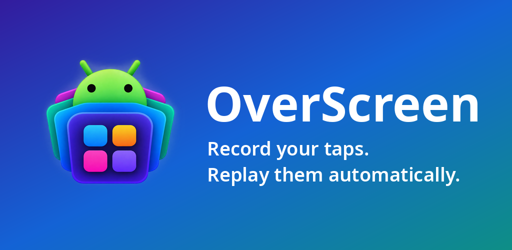
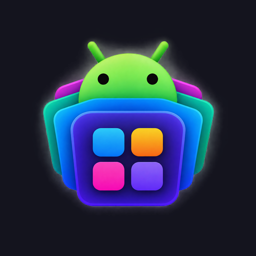
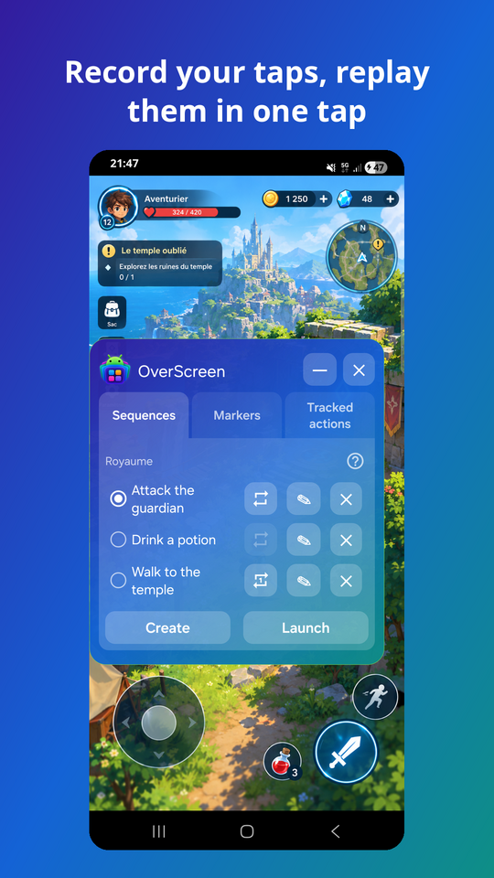
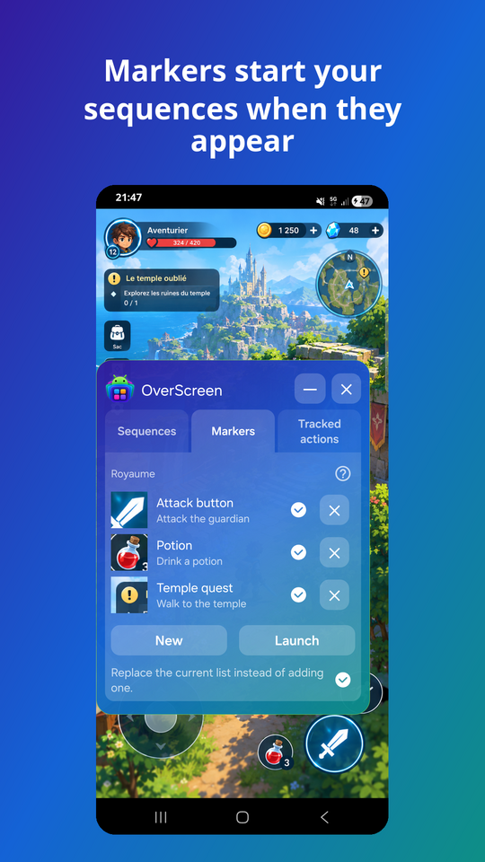
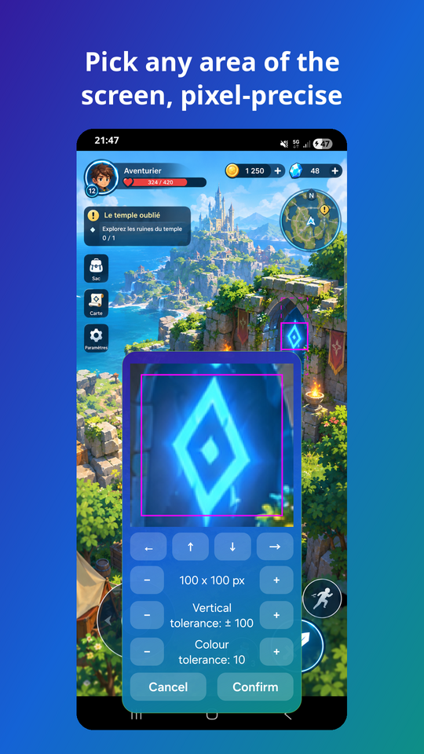
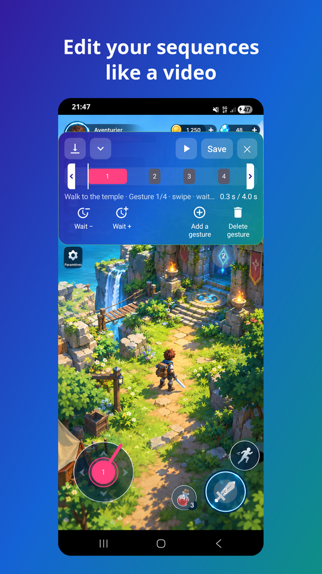
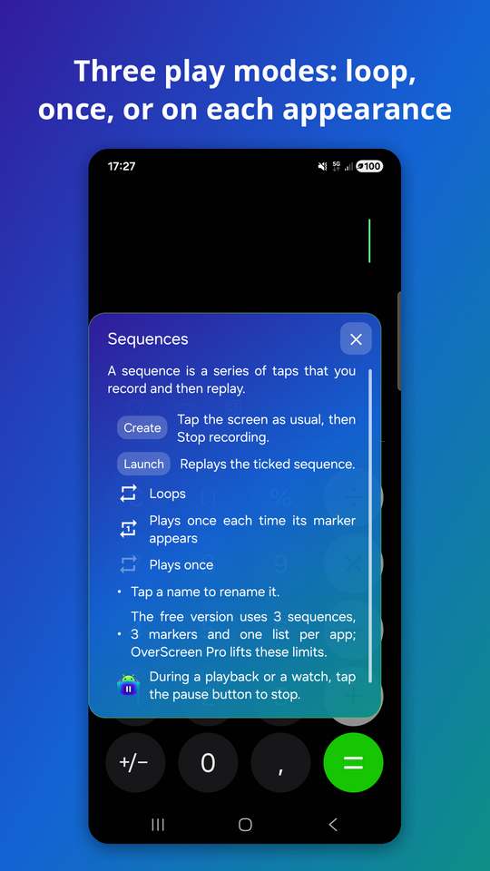
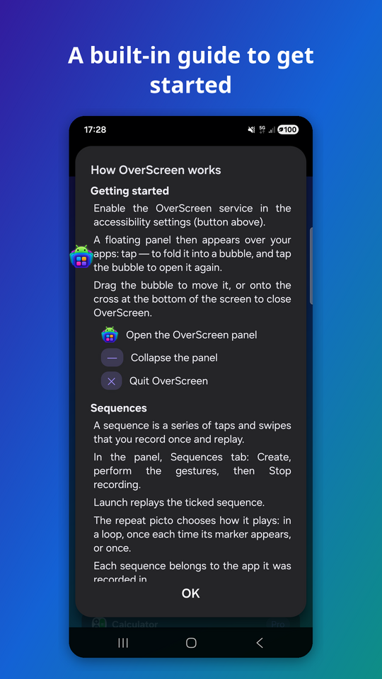

  

# OverScreen

**OverScreen** is an Android app by **ariden** that records your taps and swipes and replays them, on demand or automatically when a chosen area of the screen appears. It runs as a small floating panel over your other apps, through an accessibility service.

  <a href="https://play.google.com/store/apps/details?id=com.ariden.overload">
     
    <strong>Get OverScreen on Google Play</strong>
  </a>

## What it does

- **Record and replay**: record a series of taps and swipes in an app, then replay it in one tap, in a loop, once, or once each time its marker appears.
- **Markers**: pick any area of the screen, pixel-precise; when it appears, the linked sequence starts. A vertical and a colour tolerance keep it recognised when it moves or changes shade slightly.
- **Sequence editor**: edit a sequence like a video, with a timeline of gestures.
- **One set per app**: sequences and markers belong to the app they were created in.
- **Private**: no Internet permission, no account, no data collected. Nothing runs while the phone is locked.
- **14 languages**: English, French, Spanish, Hindi, Brazilian Portuguese, German, Russian, Japanese, Korean, Simplified and Traditional Chinese, Italian, Indonesian and Turkish.

The free version offers 3 sequences, 1 marker and one list per app. **OverScreen Pro**, a single purchase, lifts these limits and adds sequence editing, automatic actions and backup (export and import).

## Screenshots

  
  
  
  
  
  

## Ready-made configs

`configs/` holds one folder per app, with its backup file (`config.json`) and a README. To use one, download it and import it from OverScreen (backup is part of OverScreen Pro). The import adds or replaces the items of that file only and leaves the configs of your other apps untouched. It also applies the "pause when leaving the app" setting stored in the file.

| App | Config |
|---|---|
| Cinderfall | [`configs/cinderfall`](configs/cinderfall) |
| Joule Break | [`configs/joule-break`](configs/joule-break) |
| Pokemon GO | [`configs/pokemon-go`](configs/pokemon-go) |
| Rabbit Universe | [`configs/rabbit-universe`](configs/rabbit-universe) |
| Real Zombie War | [`configs/real-zombie-war`](configs/real-zombie-war) |
| Skyline Stack | [`configs/skyline-stack`](configs/skyline-stack) |
| TikTok | [`configs/tiktok`](configs/tiktok) |

## Source code

This repository holds the public pages and the ready-made configs. The app's source code lives in a separate, private repository.

## Pages

The pages are published with GitHub Pages at <https://ariden83.github.io/overscreen/>. Every page exists in English and in French, and each one links to all the others and to its translation.

| Page | English | French |
|---|---|---|
| Privacy policy | [`/`](https://ariden83.github.io/overscreen/) (`index.md`) | [`fr.html`](https://ariden83.github.io/overscreen/fr.html) (`fr.md`) |
| Terms of use | [`terms.html`](https://ariden83.github.io/overscreen/terms.html) | [`terms-fr.html`](https://ariden83.github.io/overscreen/terms-fr.html) |
| FAQ | [`faq.html`](https://ariden83.github.io/overscreen/faq.html) | [`faq-fr.html`](https://ariden83.github.io/overscreen/faq-fr.html) |
| Legal notice | [`legal.html`](https://ariden83.github.io/overscreen/legal.html) | [`legal-fr.html`](https://ariden83.github.io/overscreen/legal-fr.html) |

## Addresses in use: do not move them

These addresses are used outside this repository, so the files must keep their names; renaming this repository changes them all, because GitHub Pages does not redirect a renamed repository:

- the **privacy policy** (`/` and `fr.html`) is the privacy policy URL of the Google Play listing, and the app opens it from its consent screen;
- the **FAQ** and the **terms of use** are opened from the guide of the app;
- the Play Store listing links to the privacy policy, the terms of use and the FAQ.

## Editing a page

1. Edit the Markdown file. Pages are plain Markdown with a short front matter (`title:`); the [Primer](https://github.com/pages-themes/primer) theme set in `_config.yml` does the layout.
2. Apply the same change to the other language, so both versions always say the same thing.
3. When the privacy policy or the terms of use change in substance, update their **effective date**, in both languages.
4. Commit and push to `main`: GitHub Pages rebuilds the site within a minute or two.

To preview locally (optional): `bundle exec jekyll serve` with the `github-pages` gem, or simply open the Markdown on GitHub.

## Keeping the pages true

These pages describe what the app actually does. When the app changes in a way they mention, update them in the same move. In particular:

- **no Internet permission and no data collected**: if the app ever gets network access, analytics or ads, the privacy policy must be updated before that version is published;
- **OverScreen Pro**: the FAQ says the purchase is not available yet; update it (both languages) when the purchase is switched on in the published app;
- **legal notice**: the publisher is currently an anonymous non-professional individual; once OverScreen Pro is sold, the publisher becomes a professional and the legal notice must give their real identity.

## Contact

**ariden.apps@gmail.com**

Copyright (c) 2026 ariden. All rights reserved.
