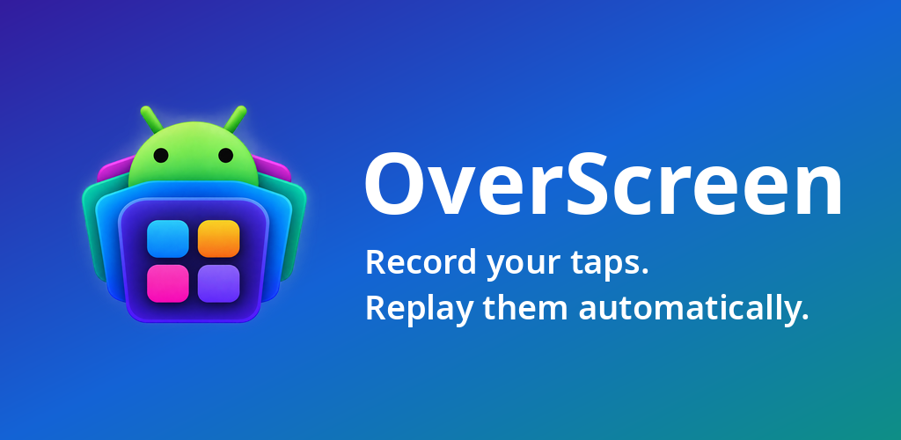
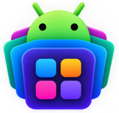
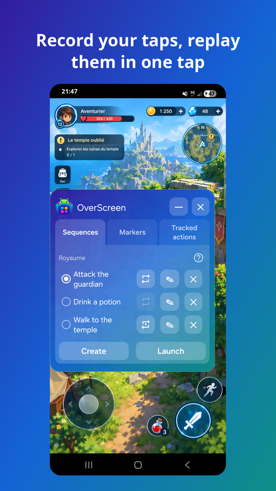
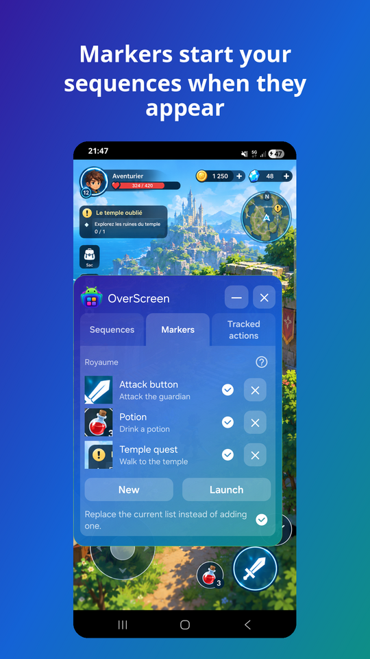
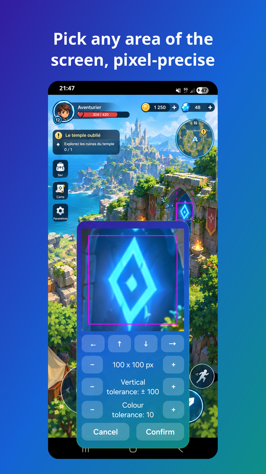
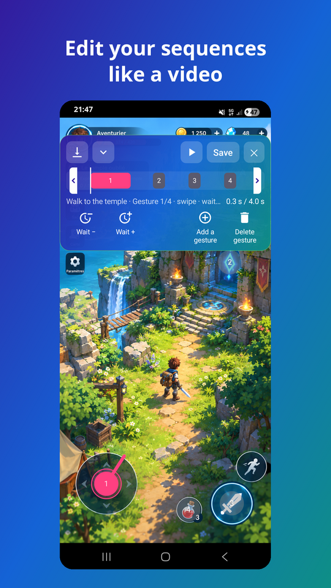
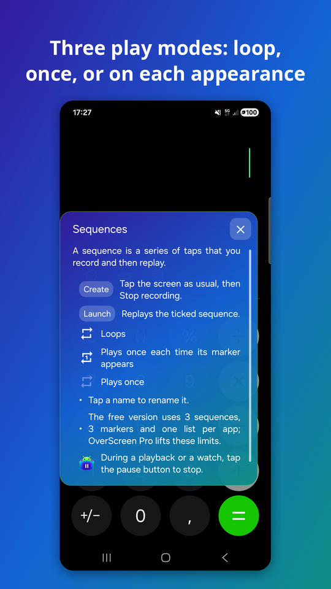
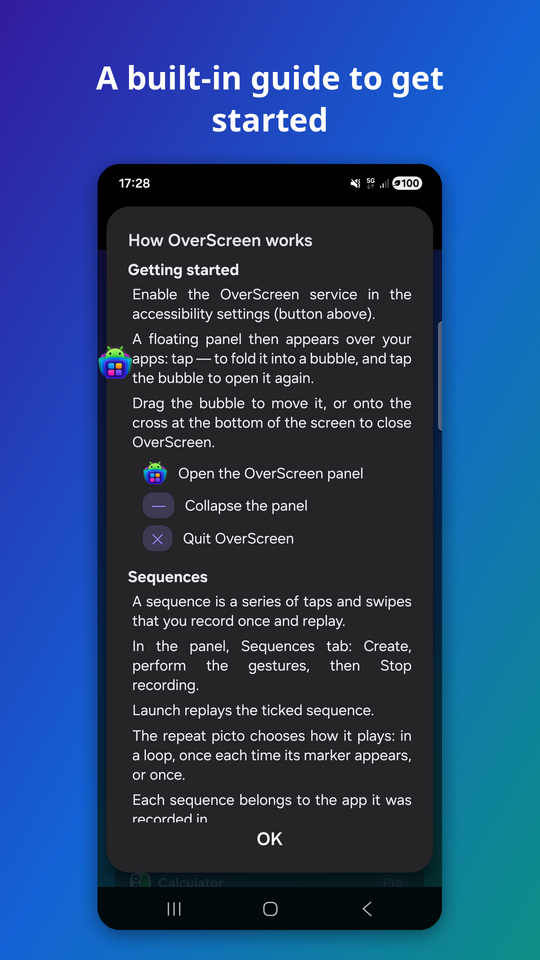

  

# &nbsp;&nbsp;&nbsp;OverScreen — Politique de confidentialité

**Politique de confidentialité** · [Conditions d'utilisation](terms-fr.md) · [FAQ](faq-fr.md) · [Mentions légales](legal-fr.md) · [English version](index.md)

Date d'entrée en vigueur : 18 novembre 2026

OverScreen (« l'application ») est publiée par **ariden** (« nous »). Cette politique explique à quelles informations l'application accède, comment elle les utilise et où elles sont conservées.

**En bref : OverScreen ne collecte, ne transmet et ne partage aucune donnée personnelle. Tout reste sur votre appareil.**

  <a href="https://play.google.com/store/apps/details?id=com.ariden.overload&hl=fr">
     
    <strong>Télécharger OverScreen sur Google Play</strong>
  </a>

## 1. Aucune donnée ne quitte votre appareil

L'application ne demande pas la permission Internet et n'a aucun accès au réseau. Elle ne contient ni publicité, ni outil de statistiques, ni rapport de plantage, ni service de suivi tiers. Elle ne nécessite aucun compte.

L'application intègre la bibliothèque de facturation de Google Play, utilisée uniquement pour l'achat facultatif décrit à la section 5. Comme l'application n'a aucune permission réseau, cette bibliothèque ne peut envoyer aucune donnée depuis l'application elle-même.

L'application intègre aussi la bibliothèque de reconnaissance de texte ML Kit de Google et un modèle de détection d'image, avec leurs modèles inclus dans l'application, utilisés uniquement pour les suggestions de repères décrites à la section 2. Ils fonctionnent entièrement sur votre appareil, ne téléchargent rien et, pour la même raison, ne peuvent rien envoyer.

Nous, l'éditeur, ne recevons aucune donnée de l'application et n'avons accès à rien de ce qui est enregistré sur votre appareil.

## 2. Service d'accessibilité

OverScreen fournit un service d'accessibilité. Il sert uniquement aux fonctions que vous déclenchez vous-même :

- **Enregistrer et rejouer des gestes** : pendant l'enregistrement d'une séquence, l'application capte les touchers et glissements que vous effectuez sur sa couche d'enregistrement, puis les rejoue à l'écran quand vous le demandez.
- **Suggérer des repères** : quand vous créez un repère, l'application peut vous suggérer les éléments à surveiller sur l'écran affiché.
  - Dans les applications qui décrivent leur écran à l'accessibilité d'Android, le service lit les éléments cliquables affichés : leur position, leur identifiant Android et leur texte. Ils vous sont proposés quand vous cochez **Détecter les éléments cliquables**.
  - Dans les jeux, qui ne décrivent pas leur écran, l'application prend une capture d'écran et, selon la case cochée (le dernier choix est mémorisé) : **Détecter les textes** y lit le texte affiché grâce à une reconnaissance de texte sur l'appareil ; **Détecter les éléments cliquables** (OverScreen Pro) l'analyse avec un modèle de détection d'image sur l'appareil, exécuté dans un processus séparé de l'application.
- **Surveiller des repères à l'écran** : quand vous lancez une surveillance, l'application vérifie vos repères à intervalles réguliers, afin de lancer la séquence associée. Les repères d'image sont comparés à leur apparence enregistrée sur des captures de l'écran affiché. Les repères créés depuis un élément cliquable sont reconnus en lisant, par le service d'accessibilité, l'élément de même identifiant ou de même texte à leur emplacement, sans aucune capture. Les repères de texte sont reconnus en relisant, par la reconnaissance de texte sur l'appareil, le texte de leur zone sur une capture.
- **Connaître l'application au premier plan** : le service lit le nom de paquet de l'application affichée, pour que séquences et repères ne s'appliquent qu'à l'application à laquelle ils appartiennent.

En dehors de ces cas, le service ne lit ni le texte ni les autres contenus de vos applications. La reconnaissance de texte et l'analyse d'image fonctionnent entièrement sur votre appareil, avec des modèles inclus dans l'application, et n'utilisent jamais le réseau.

Les captures d'écran, qu'elles servent aux suggestions ou à la surveillance, sont analysées en mémoire puis supprimées aussitôt ; elles ne sont jamais conservées ni envoyées. Seule exception, l'analyse d'image : sa capture est brièvement écrite dans le cache privé de l'application, pour la transmettre au processus d'analyse, puis supprimée dès la fin de l'analyse.

Le service d'accessibilité n'est actif qu'une fois que vous l'avez activé vous-même dans les réglages d'accessibilité de votre appareil, et vous pouvez le désactiver à tout moment au même endroit.

## 3. Informations enregistrées sur votre appareil

Les informations suivantes sont créées par vous et enregistrées uniquement dans le stockage privé de l'application, sur votre appareil :

- les séquences de gestes enregistrées (positions et durées des touchers et glissements) ;
- les repères : les pixels des petites zones d'écran que vous avez choisies, leur position et la taille de l'écran ; pour un repère créé depuis une suggestion, aussi le texte et l'identifiant Android de l'élément dont il est issu, ou le texte lu à l'écran ;
- les listes de repères, les noms que vous donnez à ces éléments, et les réglages (par exemple les applications où les actions automatiques sont activées).

Ces informations servent uniquement au fonctionnement de l'application. Elles sont supprimées quand vous les supprimez dans l'application, quand vous effacez les données de l'application ou quand vous la désinstallez.

## 4. Fichiers de sauvegarde

L'application peut exporter vos séquences, repères, listes et réglages dans un fichier de sauvegarde. Ce fichier est écrit uniquement à l'emplacement que vous choisissez dans le sélecteur de fichiers du système (par exemple le stockage de votre appareil ou une application de stockage en ligne que vous avez choisie). Ce que devient ensuite ce fichier dépend de vous et de la politique du stockage choisi. L'import lit uniquement le fichier que vous sélectionnez.

## 5. Achat facultatif (OverScreen Pro)

OverScreen s'utilise gratuitement, avec quelques limites. OverScreen Pro, qui les lève, est un achat unique facultatif effectué via Google Play.

- L'achat est entièrement géré par Google Play, au moyen de l'application Play Store de votre appareil. Vos informations de paiement sont traitées par Google et ne nous sont jamais transmises.
- L'application apprend seulement de Google Play si vous possédez OverScreen Pro, et le mémorise sur votre appareil pour que Pro fonctionne aussi hors ligne.
- La façon dont Google traite ces informations est décrite dans les [Règles de confidentialité de Google](https://policies.google.com/privacy?hl=fr).

## 6. Permissions

- **Service d'accessibilité** : décrit à la section 2.
- **Notifications** : pour vous rappeler d'activer le service.
- **Lancement au démarrage** : après un redémarrage de votre appareil, pour reprogrammer vos actions programmées. Rien d'autre ne se lance au démarrage.
- **Facturation Google Play** : permet à l'application Play Store de traiter l'achat facultatif (section 5).

## 7. Enfants

L'application ne s'adresse pas aux enfants de moins de 13 ans et ne collecte sciemment aucune information auprès de quiconque, enfants compris.

## 8. Vos droits

Comme nous ne collectons ni ne conservons aucune donnée personnelle, nous n'avons aucune donnée à consulter, corriger ou supprimer pour vous. Vous gardez le contrôle total des informations enregistrées par l'application sur votre appareil et pouvez les supprimer à tout moment, comme indiqué à la section 3.

## 9. Modifications de cette politique

Si cette politique change, la nouvelle version sera publiée sur cette page avec une nouvelle date d'entrée en vigueur.

## 10. Contact

Pour toute question sur cette politique ou sur l'application : **ariden.apps@gmail.com**

## Captures d'écran

  
  
  
  
  
  

## Vu sur

# 
